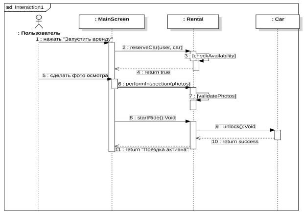

# Dachy — документация пользователя

**Разделы:** [Главная](index.md) | [Быстрый старт](quick-start.md) | [Установка](installation.md) | [Руководство](user-guide.md) | [Справка](reference.md) | [FAQ](faq.md)

---

**Dachy** — мобильное приложение для Android, которое позволяет арендовать автомобиль на короткое время (каршеринг) прямо в своём районе. Вы находите машину на карте, бронируете её, фотографируете состояние кузова и салона, едете и завершаете аренду на разрешённой парковке. Стоимость считается по фиксированным тарифам, без динамических надбавок.

## Для кого эта документация

Документация предназначена для пользователей приложения Dachy: тех, кто впервые арендует автомобиль, и тех, кому нужно быстро найти справочные данные (тарифы, статусы аренды, формулу расчёта стоимости). Если вы только начинаете, откройте [Быстрый старт](quick-start.md) — он займёт около 5 минут.

## Назначение

Приложение решает задачу «последней мили»: автомобиль должен быть в пешей доступности от пользователя. Сервис ориентирован на жителей отдельных районов (Балашиха) и предлагает:

- простой интерфейс без рекламы и лишних сервисов;
- прозрачную тарифную политику — фиксированная цена минуты, без повышающих коэффициентов в часы пик;
- юридически чистый процесс аренды: обязательная фотофиксация состояния автомобиля до и после поездки.

## Основные возможности

- **Регистрация и верификация (KYC)** по номеру телефона с подтверждением через SMS-код.
- **Карта автомобилей** в реальном времени: модель, госномер, уровень топлива.
- **Поиск и фильтр:** поиск по госномеру и фильтр по модели автомобиля.
- **Полный цикл аренды:** бронирование → осмотр → поездка (с паузой) → завершение.
- **Автоматический расчёт стоимости** по тарифу, времени, паузе и расстоянию.
- **История поездок** и **рейтинг вождения** (от 0 до 100).
- **Чат поддержки** с возможностью прикреплять фотографии.

## Как устроена документация

| Вопрос пользователя | Куда перейти |
|---|---|
| Хочу быстро начать и совершить первую поездку | [Быстрый старт](quick-start.md) |
| Как установить приложение и какие разрешения нужны? | [Установка и настройка](installation.md) |
| Как пользоваться картой, арендой, профилем, поддержкой? | [Руководство пользователя](user-guide.md) |
| Какие тарифы, статусы, формулы и API-запросы? | [Справочная информация](reference.md) |
| Что-то не работает, нужен ответ на частый вопрос | [FAQ и устранение неисправностей](faq.md) |

## Схема работы приложения

Ниже показан сценарий запуска аренды: пользователь взаимодействует с экраном приложения, а вся логика сессии и управление замками выполняются на стороне сервера.

> **Примечание:** подробное описание этапов аренды приведено в разделе [Руководство пользователя](user-guide.md#процесс-аренды-автомобиля).
