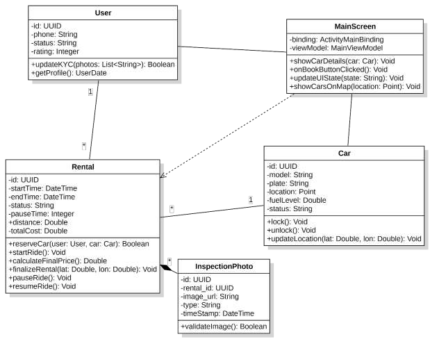
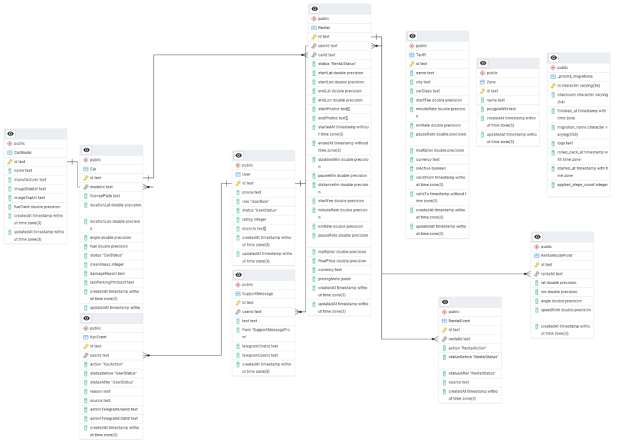

# Справочная информация

**Разделы:** [Главная](index.md) | [Быстрый старт](quick-start.md) | [Установка](installation.md) | [Руководство](user-guide.md) | [Справка](reference.md) | [FAQ](faq.md)

---

Технические сведения о приложении Dachy: тарифы, статусы, формула стоимости, API и архитектура.

**Содержание:**

- [Тарифы](#тарифы)
- [Формула стоимости поездки](#формула-стоимости-поездки)
- [Статусы аренды](#статусы-аренды)
- [Разрешения приложения](#разрешения-приложения)
- [API-запросы](#api-запросы)
- [Архитектура и технологии](#архитектура-и-технологии)
- [Глоссарий](#глоссарий)

## Тарифы

Модель ценообразования фиксированная, динамического повышения цены нет. Во всех моделях автопарка базовая ставка — **от 8.5 ₽/мин**.

| Модель | Тариф |
|---|---|
| Volkswagen Polo VI | от 8.5 ₽/мин |
| Chery Tiggo 4 | от 8.5 ₽/мин |
| Chery Tiggo 7 Pro | от 8.5 ₽/мин |
| Sollers Atlant | от 8.5 ₽/мин |
| Ford Transit | от 8.5 ₽/мин |
| FAW Bestune T77 | от 8.5 ₽/мин |
| Geely Coolray | от 8.5 ₽/мин |

## Формула стоимости поездки

```text
Итого = StartFee + (ActiveMinutes × MinuteRate) + (DistanceKm × KmRate) + (PauseMinutes × PauseRate)
```

| Параметр | Описание |
|---|---|
| `StartFee` | Стоимость старта аренды |
| `ActiveMinutes` | Минуты активной поездки |
| `MinuteRate` | Цена минуты (от 8.5 ₽) |
| `DistanceKm` | Пройденное расстояние, км |
| `KmRate` | Цена километра |
| `PauseMinutes` | Минуты в режиме паузы |
| `PauseRate` | Цена минуты паузы (пониженный тариф) |

> **Примечание:** в начале поездки на экране показывается ненулевой «Итог» (на примере — 50 ₽ при времени 0 мин): это начальная плата за старт.

## Статусы аренды

Сессия аренды управляется конечным автоматом. Переходы строго последовательны, каждое изменение записывается в журнал событий (аудит).

```text
reserved → inspection → active → paused → finished
```

| Статус | Что означает | Что видит пользователь |
|---|---|---|
| `reserved` | Автомобиль закреплён за пользователем | «Бронирование» |
| `inspection` | Идёт осмотр и фотофиксация | Чек-лист и загрузка фото |
| `active` | Замки открыты, поездка идёт | «Поездка идёт» |
| `paused` | Автомобиль в режиме ожидания | Пауза, пониженный тариф |
| `finished` | Аренда завершена | «Аренда завершена» |

## Разрешения приложения

| Разрешение | Назначение |
|---|---|
| Геолокация | Карта и поиск ближайших авто |
| Камера | KYC и фотоосмотр |
| Хранилище | Выбор фото из галереи |

Подробнее — в разделе [Установка и настройка](installation.md#разрешения).

## API-запросы

Базовый адрес сервера: `https://apidachy.panainte.ru/v1`. Авторизованные запросы передают JWT-токен в заголовке `Authorization: Bearer <token>`.

| Метод | Путь | Назначение |
|---|---|---|
| POST | `/auth/register` | Регистрация по номеру телефона |
| POST | `/auth/verify-sms` | Проверка SMS-кода, выдача токена |
| GET | `/cars` | Список автомобилей |
| POST | `/rentals/reserve` | Бронирование автомобиля |
| POST | `/rentals/start` | Старт аренды (с фото осмотра) |
| POST | `/rentals/stop` | Завершение аренды (координаты и фото) |
| POST | `/support/message` | Сообщение в поддержку |
| POST | `/uploads` | Загрузка изображения |

### Пример: вход и бронирование

```bash
# 1. Запросить SMS-код
curl -X POST https://apidachy.panainte.ru/v1/auth/register \
  -H "Content-Type: application/json" \
  -d '{"phone": "+79001234567"}'

# 2. Подтвердить код и получить токен (поле access_token в ответе)
curl -X POST https://apidachy.panainte.ru/v1/auth/verify-sms \
  -H "Content-Type: application/json" \
  -d '{"phone": "+79001234567", "code": "1234"}'

# 3. Забронировать автомобиль
curl -X POST https://apidachy.panainte.ru/v1/rentals/reserve \
  -H "Authorization: Bearer <access_token>" \
  -H "Content-Type: application/json" \
  -d '{"car_id": "<id автомобиля>"}'
```

**Назначение:** примеры показывают, как приложение общается с сервером при входе и бронировании. Первый запрос отправляет SMS, второй возвращает `access_token`, третий закрепляет автомобиль за пользователем.

**Результат:** сервер возвращает данные активной аренды в статусе `reserved`.

**Когда использовать:** для тестирования и отладки API. Обычному пользователю эти запросы вручную выполнять не нужно — приложение делает это само.

> **Важно:** значения `phone`, `code`, `<access_token>` и `<id автомобиля>` замените своими; код приходит в SMS.

## Архитектура и технологии

| Компонент | Технология |
|---|---|
| Мобильный клиент | Flutter (Dart) |
| Серверная часть | NestJS (TypeScript), Prisma ORM |
| База данных | PostgreSQL + PostGIS (геозоны парковки) |
| Хранилище фото | MinIO (S3-совместимое) |
| Обратный прокси | Caddy (автоматический SSL/TLS) |
| Карты | Yandex MapKit |
| Реальное время | Socket.IO, периодический опрос (polling, 15 с) |





## Глоссарий

| Термин | Значение |
|---|---|
| KYC | Верификация личности клиента (проверка документов) |
| Геозона | Разрешённая область парковки для завершения аренды |
| JWT | Токен авторизации пользователя |
| State Machine | Конечный автомат, управляющий статусами аренды |
| Телеметрия | Данные об автомобиле: координаты, топливо, угол поворота |

[← Вернуться на главную страницу](index.md) · [К руководству пользователя](user-guide.md)
