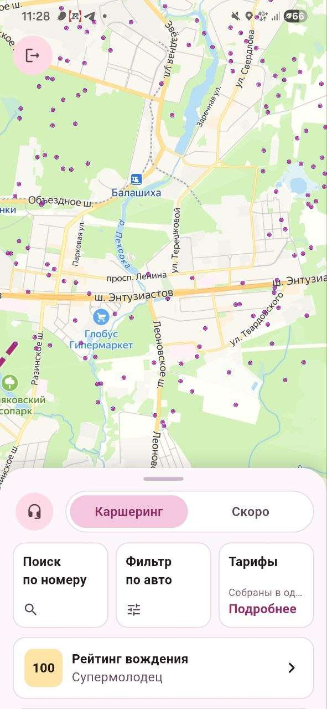
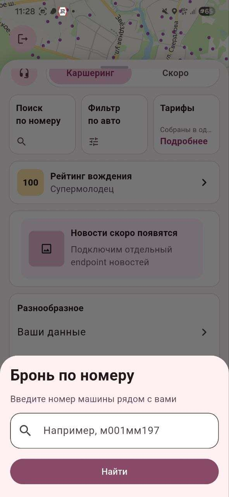
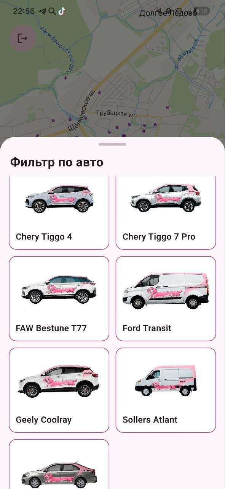
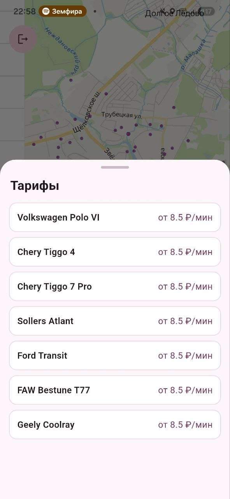
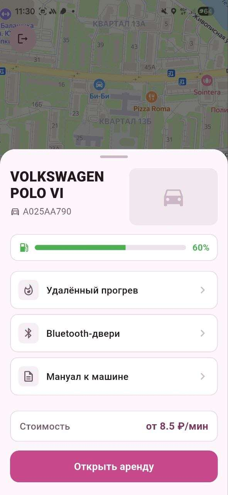
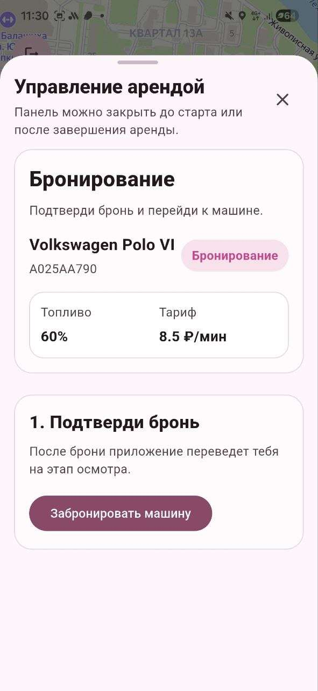
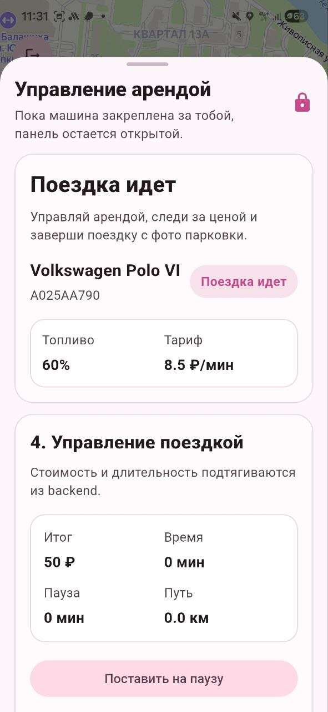
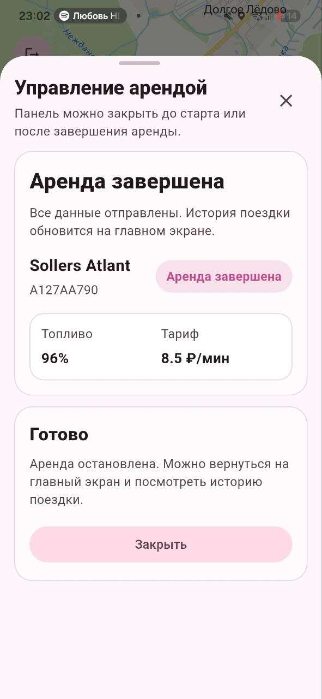
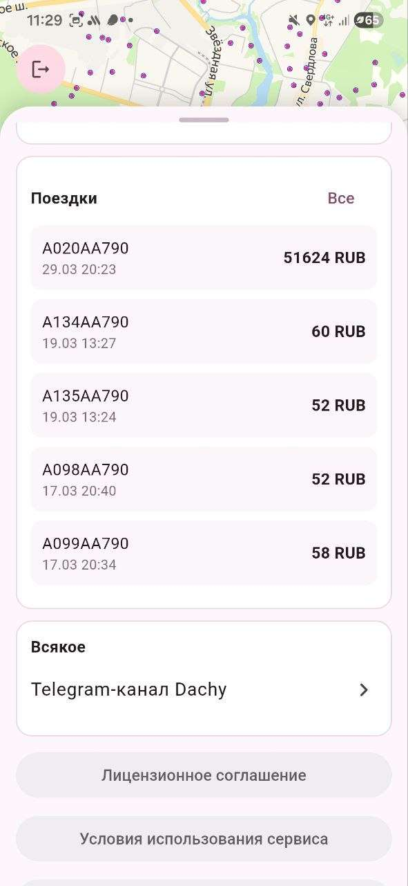
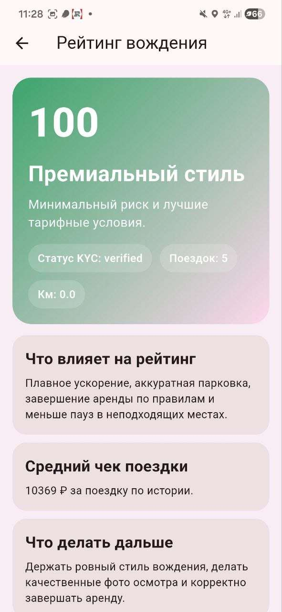

# Руководство пользователя

**Разделы:** [Главная](index.md) | [Быстрый старт](quick-start.md) | [Установка](installation.md) | [Руководство](user-guide.md) | [Справка](reference.md) | [FAQ](faq.md)

---

Здесь описаны все основные операции в приложении Dachy.

**Содержание:**

- [Главный экран и карта](#главный-экран-и-карта)
- [Поиск и фильтр автомобилей](#поиск-и-фильтр-автомобилей)
- [Процесс аренды автомобиля](#процесс-аренды-автомобиля)
- [Профиль и история поездок](#профиль-и-история-поездок)
- [Рейтинг вождения](#рейтинг-вождения)
- [Обратная связь](#обратная-связь)

## Главный экран и карта

Центральную часть главного экрана занимает интерактивная карта с масштабированием и панорамированием. Доступные автомобили отображаются маркерами: при удалении карты — точками, при приближении — изображениями моделей.

В нижней части расположена выдвижная панель:

- **Каршеринг** — основная вкладка с инструментами поиска;
- **Скоро** — новости и будущие функции (например, «Клуб Dachy»);
- **Поиск по номеру**, **Фильтр по авто**, **Тарифы** — быстрые кнопки;
- **Рейтинг вождения** — ваш текущий рейтинг;
- иконка наушников — переход в чат поддержки.



## Поиск и фильтр автомобилей

### Поиск по госномеру

1. Нажмите **«Поиск по номеру»**.
2. Введите номер машины, которая стоит рядом, например `м001мм197`.
3. Нажмите **«Найти»** — карта перейдёт к автомобилю.



### Фильтр по модели

Нажмите **«Фильтр по авто»** и выберите модель из каталога. На карте останутся только автомобили выбранной модели.



### Тарифы

Кнопка **«Тарифы»** открывает список моделей с ценой за минуту. Подробнее о расчёте — в [Справке](reference.md#тарифы).



## Процесс аренды автомобиля

Аренда состоит из пяти последовательных этапов. Пропустить этап нельзя — это обеспечивает безопасность и юридическую чистоту сделки.

```text
Бронирование → Осмотр → Запуск → Поездка (пауза) → Завершение
```

### 1. Бронирование

Выберите автомобиль на карте. Откроется карточка с моделью, госномером, уровнем топлива и тарифом. Нажмите **«Открыть аренду»**, затем **«Забронировать машину»** — автомобиль закрепится за вами.





### 2. Осмотр перед стартом

Перед началом движения необходимо:

1. отметить все пункты чек-листа: «Кузов без новых повреждений», «Салон и приборная панель в порядке», «Документы и уровень топлива проверены»;
2. прикрепить **минимум 2 фотографии** — сделать через встроенную камеру или выбрать из галереи.

> **Важно:** если на автомобиле есть повреждения, сфотографируйте их — это защитит вас от необоснованных претензий.

### 3. Запуск аренды

После успешной проверки фотографий становится активна кнопка **«Запустить аренду»**. Приложение отправит команду на разблокировку замков, статус сменится на **«Поездка идёт»**.

### 4. Управление поездкой

На экране в реальном времени показываются:

| Показатель | Что означает |
|---|---|
| Итог | Текущая стоимость аренды |
| Время | Длительность поездки |
| Пауза | Время в режиме ожидания |
| Путь | Пройденное расстояние |

Кнопка **«Поставить на паузу»** переводит автомобиль в режим ожидания с пониженным тарифом. Данные обновляются автоматически каждые 15 секунд.



### 5. Завершение аренды

1. Припаркуйте автомобиль **в разрешённой геозоне** — сервер проверит координаты автоматически.
2. Нажмите **«Перейти к завершению»**.
3. Поставьте галочку **«Машина припаркована корректно и закрыта»**.
4. Сделайте финальное фото парковки.
5. Нажмите **«Завершить аренду»**.



> **Предупреждение:** вне разрешённой геозоны завершить аренду не получится — переместите автомобиль на парковку.

## Профиль и история поездок

Раздел **«Ваши данные»** содержит номер телефона, рейтинг, статус KYC и роль в системе. Статус `verified` обязателен для бронирования.


История поездок находится на главном экране в блоке **«Поездки»**. Для каждой поездки показаны госномер, дата и время, итоговая стоимость. Кнопка **«Все»** открывает полный список, а выбор поездки — детальный отчёт.



## Рейтинг вождения

Рейтинг — число от 0 до 100. Он зависит от плавности ускорения, аккуратности парковки, завершения аренды по правилам и количества пауз в неподходящих местах. Высокий рейтинг даёт лучшие тарифные условия.



## Обратная связь

Чат поддержки открывается иконкой наушников на главном экране. Опишите проблему, прикрепите фото с камеры или из галереи и отправьте сообщение. Сообщения доставляются администратору, история диалога синхронизируется с сервером. Кнопка **«Обновить»** перезагружает чат.


Если чат показывает ошибку, см. [FAQ](faq.md#ошибка-http-500-в-чате-поддержки).

## Что дальше

- Справочные данные: [тарифы, статусы, API](reference.md).
- Ответы на частые вопросы: [FAQ](faq.md).

[← Вернуться на главную страницу](index.md)
